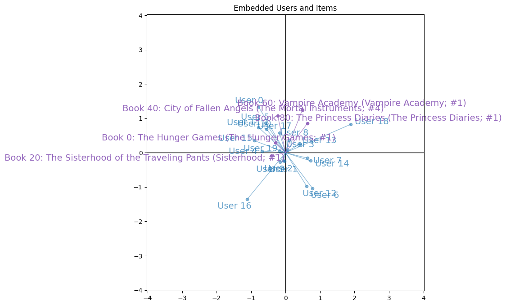

# Latent Factor Recommender System: Book Ratings

A matrix-factorization recommender trained with
stochastic gradient descent to predict Goodreads book ratings.

## Background

The data comes from real Goodreads ratings collected in the
[UCSD Book Graph](https://sites.google.com/eng.ucsd.edu/ucsdbookgraph/home)
(Wan & McAuley, RecSys'18; Wan, Misra, Nakashole & McAuley, ACL'19). The subset
used here is the **young adult** collection:

| | |
|---|---|
| Books (items) | 500 |
| Users | 1,002 |
| Ratings | 10,000 |

Ratings are mean-centered at 0, so a positive predicted score means
"above-average enjoyment" and a negative score the opposite. Book metadata lives
in `data/books.csv`; the rating triples `(user_index, book_index, rating)` are in
`data/ratings_train.csv` and `data/ratings_val.csv`. A much smaller synthetic
dataset (`rec_load_tiny_data()`) is used for unit-testing the implementation.

The task is collaborative filtering: the rating matrix is almost entirely
unobserved (10,000 of 501,000 possible user–book pairs), so instead of filling in
the matrix directly we learn a low-dimensional embedding for every user and every
book, and predict a rating as the dot product of the two.

## Model

Each user $i$ gets a vector $u_i ∈ ℝ^K$ (row of $U$) and each book $j$ a vector
$v_j ∈ ℝ^K$ (row of $V$). The predicted rating is $u_i^ᵀv_j$, and the
objective is the mean squared error over the observed ratings $S$ only:

$$
J(U, V) = \frac{1}{N} \Sigma_{(i,j,r) ∈ S}  \frac{1}{2}(r − u_i^ᵀv_j)^2
$$

**Optimization** is performed with plain SGD, one observed rating at a time, in dataset order, without explicit regularization.
For each triple `(i, j, r)` only the two vectors involved are touched:

```
e     = r − uᵢᵀvⱼ
uᵢ   ← uᵢ + α · e · vⱼ
vⱼ   ← vⱼ + α · e · uᵢ
```

**U** and **V** are initialized from a standard normal with a seed for reproducibility purposes.

## Results

**Book dataset** (K=2)

| α | Epochs | Training loss |
|---|---|---|
| 0.01 | 20 | 0.31474 |
| 0.01 | 40 | 0.28085 |
| 0.01 | 60 | 0.24386 |
| 0.01 | 80 | 0.21215 |
| 0.01 | 100 | 0.18855 |
| 0.01 | 120 | 0.17128 |
| 0.01 | 140 | 0.15858 |
| 0.01 | 160 | 0.14832 |
| 0.01 | 180 | 0.13993 |
| 0.01 | 200 | 0.13353 |

The loss decreases monotonically throughout training; with α=0.01 it falls from
≈0.315 at epoch 20 to ≈0.134 at epoch 200, still descending but clearly
flattening out. The results is a **well-structured** latent space, where similar users/books obtain similar embedding vectors:

**Example embeddings visualization of the first 20 users and 5 book embedding vectors in 2D**
<p align="center">
  
</p>

### Example predictions for user 0

Using the K=2, α=0.01, 200-epoch model, predicted ratings $u_0^ᵀv_j$ for the
four candidate books:

| Book | Index | Predicted rating |
|---|---|---|
| The Lightning Thief | 6 | 0.769 |
| The Sorceress | 282 | **−1.999** |
| Halo | 301 | **1.571** |
| An Ember in the Ashes | 419 | 0.572 |

**Interpretation: user 0 would enjoy *Halo* the most (≈1.571) and *The Sorceress* the least
(≈−1.999).** The plot of these four book vectors together
with the user-0 vector (see below) shows why: *Halo* points in roughly the same direction as
user 0's embedding, while *The Sorceress* points nearly opposite to it.

**Embeddings visualization of user 0 and 4 book embedding vectors in 2D**
<p align="center">
  
</p>

## Installation

```bash
git clone https://github.com/kierancarroll/Latent-Factor-Recommender-System.git
cd Latent-Factor-Recommender-System
```

## Usage

```bash
python3 run.py
```

Predict a single rating and inspect the embedding space:

```python
predicted = U[0] @ V[301]          # user 0's score for book index 301

visualize_embeddings(user_embeddings=U,
                     book_embeddings=V,
                     user_indices_to_display=[0],
                     item_indices_to_display=[6, 282, 301, 419],
                     book_titles=book_titles)
```